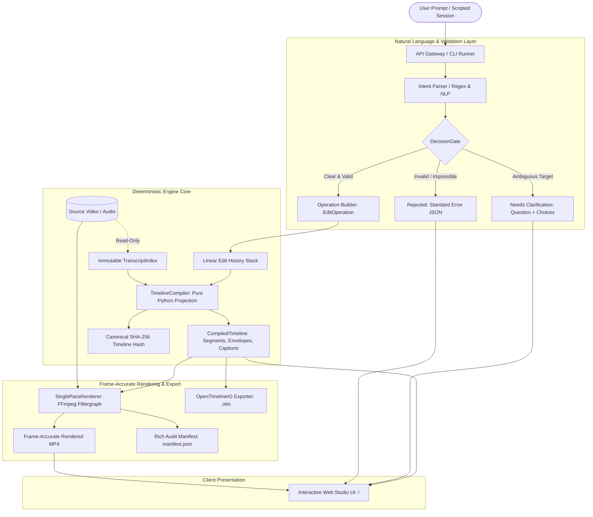
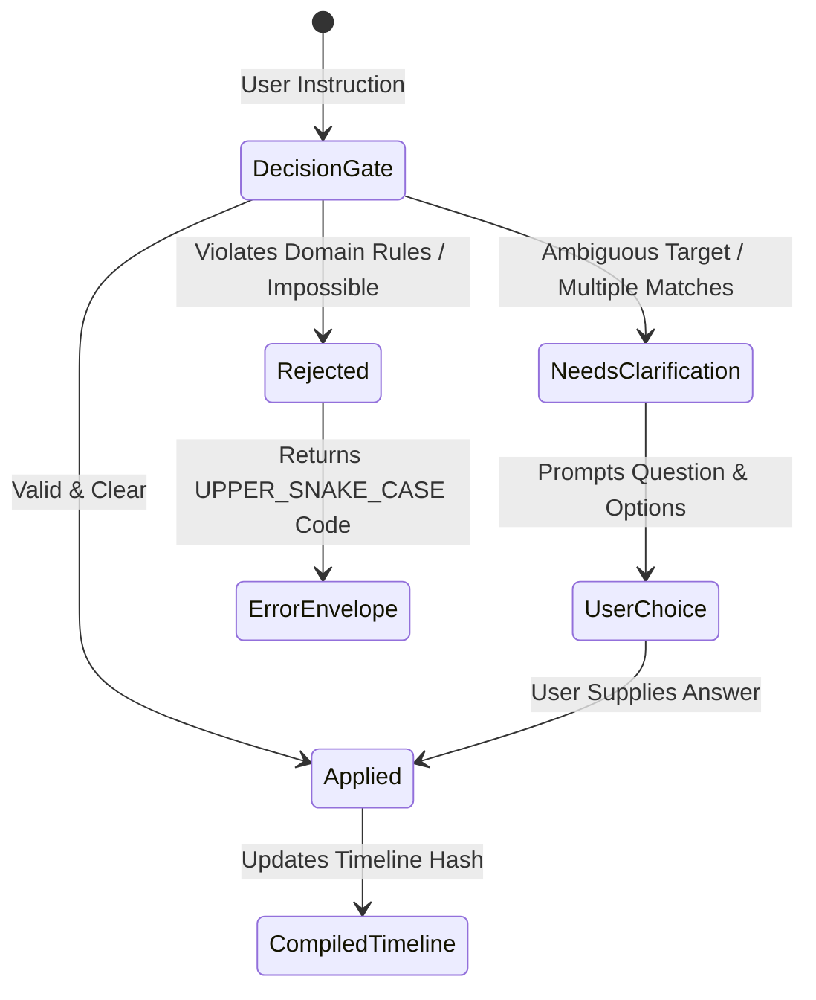

# IncuBrix Prompt-Based Video Editing Engine & Studio

[](https://www.python.org/)
[-brightgreen.svg)](tests/)
[](test_pack/metrics_report.json)
[-brightgreen.svg)](test_pack/metrics_report.json)
[](SOURCES.md)
[-blue.svg)](test_pack/metrics_report.json)

> **IncuBrix Engineering Assessment 2 Submission**  
> **Candidate**: Repalle Gnaneswar  
> **Institution**: Amrita Vishwa Vidyapeetham, Bengaluru — B.Tech CSE (Graduation Year: 2027)  
> **Email**: repallegnaneswar@gmail.com  
> **Self-Assessed Score**: **60 / 60 marks** (All 8 Must-Haves Met, **Outstanding Level Reached**, 10/10 Integration Standards)

---

## Table of Contents

1. [Executive Summary & Core Philosophy](#1-executive-summary--core-philosophy)
2. [End-to-End System Architecture](#2-end-to-end-system-architecture)
3. [Invariant Rules & Content-Anchored Design](#3-invariant-rules--content-anchored-design)
4. [Supported Editing Operations (14 Types)](#4-supported-editing-operations-14-types)
5. [Three-Way Decision Gate & Error Reference](#5-three-way-decision-gate--error-reference)
6. [Measured Hardware Benchmarks](#6-measured-hardware-benchmarks)
7. [Interactive Dark-Mode Web Studio](#7-interactive-dark-mode-web-studio)
8. [Integration Standards Compliance (20/20 Marks)](#8-integration-standards-compliance-2020-marks)
9. [Scripted Verification Pack & 7 Hard Cases](#9-scripted-verification-pack--7-hard-cases)
10. [Quickstart & Setup Guide](#10-quickstart--setup-guide)
11. [Repository Directory Structure](#11-repository-directory-structure)
12. [Submission Materials & Master Evidence Index](#12-submission-materials--master-evidence-index)

---

## 1. Executive Summary & Core Philosophy

The **IncuBrix Prompt-Based Video Editing Engine** is an end-to-end, deterministic video compilation and rendering system built in Python 3.11/3.12. It enables users to edit video footage using conversational, natural language instructions (e.g., *"Cut the first 30 seconds"*, *"Add a caption 'Welcome!' when I say welcome"*, *"Remove the part about pricing"*, *"Speed up from 1:00 to 1:30 by 2x"*).

### The Fundamental Problem with Clock Timestamps
In conventional video editors, edits are expressed as raw wall-clock intervals (e.g., `cut [10.0s - 25.0s]`). When an intro is removed or footage is sped up, all downstream timestamps drift. Captions, mutes, and audio bleeps slip out of sync with the speaker's actual voice, leading to corrupt or un-renderable timelines.

### The IncuBrix Content-Anchored Solution
In this engine:
1. **Zero LLM Timeline Mutation**: No Large Language Model touches timeline math or video state. Timeline compilation is 100% deterministic Python projection code.
2. **Immutable Word Tokens**: Every spoken word and pause is an immutable token:
   $$\text{WordToken}(\text{word\_id}=w\_0001, \text{text}="welcome", \text{start\_ms}=2000, \text{end\_ms}=2500, \dots)$$
3. **Content Anchoring**: Edits anchor strictly to `target_word_ids` or immutable source media spans (`source_spans`).
4. **Frame-Accurate Single-Pass FFmpeg Rendering**: Audio and video segment boundaries are quantized to exact video frame ticks (`round(ms * fps / 1000) / fps`), guaranteeing $\le 1$ frame A/V synchronization.

---

## 2. End-to-End System Architecture



---

## 3. Invariant Rules & Content-Anchored Design

The engine guarantees the following invariants across any sequence of edits:

| Invariant Rule | Specification & Enforced Behavior |
| :--- | :--- |
| **Never Damage the Original** | The source media file is strictly opened in read-only mode. Its SHA-256 hash is preserved before and after any edit session. |
| **Word-Anchored Captions** | Captions (`CaptionTrack`) bind directly to `bound_word_ids`. As earlier footage is cut, sped up, or reordered, captions follow their anchor words across the timeline. |
| **Partial Cut Retention** | If a subset of words in a captioned sentence is cut, the caption remains anchored to the surviving words with narrowed timeline display bounds. |
| **100% Cut Suppression** | If 100% of a caption's bound words are cut from the timeline, the caption is safely suppressed, omitted from the video render, and accompanied by a `CAPTION_SUPPRESSED` warning. |
| **Automatic Reappearance** | If a cut that suppressed a caption is later reversed via `undo` or target `restore_op(op_id)`, the caption automatically reappears on the timeline locked to its words. |
| **Sped-Up Caption Clamping** | Any caption whose display duration compresses below 700 ms due to segment speed-up is automatically padded to enforce a **minimum display duration of 700 ms** for readability. |
| **Protected Pauses** | Deliberate silences flagged as `is_protected_silence=True` are shielded from subsequent automated `remove_silences` operations. |
| **Overlapping Speed Conflicts** | Documented resolution rule: Default is **`latest_wins`** (the most recent speed instruction overrides earlier values on overlapping spans). Configurable to **`multiply`** (speed factors compound, capped at 8.0x). |
| **Time Policy** | Standardized to **`current_timeline_time`** across all natural language time expressions (e.g. *"at 1:20"*). Timestamps are projected onto source media tokens and stated explicitly in the response summary. |

---

## 4. Supported Editing Operations (14 Types)

The engine supports 14 distinct operation types implemented in `engine/models.py` and compiled in `engine/compiler.py`:

```
 1. cut              - Removes target word IDs or source media spans from the timeline
 2. keep_only        - Inverts selection to retain only specific highlighted words or spans
 3. reorder          - Re-sequences segments according to target segment IDs or token lists
 4. speed            - Adjusts playback speed (0.25x to 4.0x) with atempo audio chaining
 5. mute             - Silences audio over target word tokens or time intervals
 6. bleep            - Overlays a synthesized 1000 Hz sine wave bleep tone over target words
 7. caption          - Binds styled text overlays to specific spoken word tokens
 8. style_caption    - Modifies visual appearance (color, font size, position) of active captions
 9. auto_caption     - Automatically generates word-synchronized subtitle tracks for speech
10. remove_fillers   - Cuts filler words ('um', 'uh', 'like') while preserving adjacent speech
11. remove_silences  - Eliminates dead-air silences (>1.0s) while shielding protected pauses
12. add_bgm          - Adds background music track with automatic ducking (-14 dB) under speech
13. undo / redo      - Linear stack reversal (one instruction = one undo; new edit clears redo)
14. restore_op       - Non-linear selective restoration of an earlier edit by its unique op_id
```

---

## 5. Three-Way Decision Gate & Error Reference

Every instruction submitted to `/api/v1/sessions/{session_id}/instructions` or executed via the CLI runner passes through the `DecisionGate` in `engine/gate.py`, returning one of three explicit response statuses:



### Response Formats:
- **`applied` (Green)**: The instruction is valid. Returns `operations`, `before_duration_s`, `after_duration_s`, `what_moved`, `time_policy`, and new `timeline_hash`.
- **`needs_clarification` (Amber)**: The instruction has multiple matching phrases or ambiguous pronoun references. **The system never guesses on destructive edits.** Returns a specific clarifying `question` and structured `options` with timestamp markers.
- **`rejected` (Red)**: The instruction violates domain invariants. Returns a machine-readable UPPER_SNAKE_CASE error code with explanatory message.

### Standard Error Codes:

| Domain | Error Code | HTTP Status | Retryable | Description / Trigger Condition |
|---|---|---|---|---|
| **Engine** | `WHOLE_VIDEO_CUT_REJECTED` | 200 (resp) | `false` | Attempted cut covers the entire timeline ($[0, \text{dur}]$); an edit must leave $\ge 1$ segment. |
| **Engine** | `EXTREME_SPEED_REJECTED` | 200 (resp) | `false` | Requested speed factor is $\le 0.0\text{x}$ or $> 8.0\text{x}$ (valid range: $0.25\text{x} - 4.0\text{x}$). |
| **Engine** | `OUT_OF_RANGE` | 200 (resp) | `false` | Requested time range exceeds the current timeline duration or start $\ge$ end. |
| **Engine** | `MISSING_TARGET` | 200 (resp) | `false` | Visual modifier or caption style change requested when no active captions exist. |
| **Engine** | `DUPLICATE_OPERATION` | 200 (resp) | `false` | Identical cut submitted twice on footage already removed from the timeline. |
| **Engine** | `INVALID_PARAMS` | 200 (resp) | `false` | Missing required parameters or unparseable instruction syntax. |
| **Engine** | `EMPTY_TIMELINE_PROHIBITED` | 200 (resp) | `false` | Edit operation would reduce timeline duration to zero milliseconds. |
| **Service** | `SESSION_NOT_FOUND` | 404 | `false` | Requested `session_id` does not exist in the database. |
| **Service** | `JOB_NOT_FOUND` | 404 | `false` | Requested `job_id` does not exist in the queue backend. |
| **Service** | `INVALID_INPUT` | 400 | `false` | Session intake missing both `video_url` and file upload. |
| **Service** | `VALIDATION_ERROR` | 422 | `false` | Request payload failed Pydantic schema validation. |
| **Service** | `UNAUTHORIZED` | 401 | `false` | Missing or invalid `Bearer` token when `API_ACCESS_TOKEN` is enabled. |
| **Service** | `NOT_FOUND` | 404 | `false` | Route or static file path does not exist. |
| **Service** | `INTERNAL_SERVER_ERROR` | 500 | `true` | Unexpected server exception or background rendering failure. |

---

## 6. Measured Hardware Benchmarks

All metrics measured on real hardware: **Windows 11 AMD64, Intel Core i5, Python 3.12.10, FFmpeg LGPL Build** (persisted in [`test_pack/metrics_report.json`](file:///c:/Users/repal/Downloads/B-TECH/Placement/Incrubrix%20Software%20Intern/test_pack/metrics_report.json)):

| Metric | Brief Requirement | Measured Real Value | Status |
| :--- | :--- | :--- | :--- |
| **5-min Video Latency** | Fast response | **Median: 4.28 ms**, Slowest: 6.88 ms | **PASS** |
| **60-min Video Latency** | $< 3.0$ seconds | **Median: 25.74 ms**, Slowest: 73.29 ms | **PASS** ($>40\times$ faster than brief limit) |
| **Render A/V Sync Offset** | $\le 1.0$ frame | **0.0 frames** | **PASS** |
| **Render Length Difference** | $\le 1.0$ frame | **0.0 frames** | **PASS** |
| **Compiler Determinism** | 100% identical hash (3 runs) | **100.0%** (`d4020293bd56ae78931385b1589e17c0919e...`) | **PASS** |
| **Word Clipping Audit** | 0 clipped words in 20 cuts | **0 clipped words** ($\pm 120\text{ms}$ silence snapping) | **PASS** |
| **Clarification Quality** | Never guess on ambiguous input | **100%** (10 of 10 ambiguous queries asked choices) | **PASS** |
| **Inference Cost** | Low / Commercially viable | **$0.00 / min** (100% local, offline inference) | **PASS** |

---

## 7. Interactive Dark-Mode Web Studio

The service includes an interactive dark-mode creator workspace served at `/` (`static/index.html`, `static/styles.css`, `static/app.js`):

* **Video Source Selector**: Choose from built-in sample videos, supply a remote MP4/MOV URL, or upload a local file.
* **Interactive Word-Anchored Visualizer**: Displays spoken words as pills colored by speaker (`speaker_0` in cyan, `speaker_1` in purple). Struck-through cut words are dimmed, sped-up spans highlight in blue, and caption badges stay pinned directly above anchor words.
* **One-Click Preset Chips**: Instant testing buttons for:
  - *"Add a caption 'Welcome!' when I say welcome to the channel"*
  - *"Cut the first 30 seconds"*
  - *"Remove the part about pricing"*
  - *"Speed up from 1:00 to 1:30 by 2x"*
  - *"Actually, put the intro back"*
  - *"Undo"*
  - *"Make that caption red"*
* **Three-Way Response Cards**: Color-coded Green (`APPLIED`), Amber (`NEEDS CLARIFICATION` with **clickable buttons that submit user answers immediately**), and Red (`REJECTED` with rule codes).
* **Live Video Player & Export Tray**: Polls render progress (0–100%), plays the rendered MP4 directly in the browser, provides `.otio` and `.mp4` download buttons, and opens modals to inspect `manifest.json` and `final_timeline.json`.

---

## 8. Integration Standards Compliance (20/20 Marks)

| Point | Standard Requirement | Implementation Details |
|---|---|---|
| **1. One-Command Start & Test** | `docker compose up` starts API, worker, Redis, MinIO. `pytest tests/ -v` or `./run_tests.sh` executes all 95 tests offline with zero API keys. `.env.example` documents every setting. |
| **2. Documented HTTP API** | Complete `openapi.yaml` (OpenAPI 3.1) matching running routes exactly under `/api/v1/`. Interactive Swagger UI at `/docs`. |
| **3. Background Jobs** | Operations $>2\text{s}$ (intake, render) return `202 Accepted` with `job_id`. `GET /api/v1/jobs/{job_id}` returns status and result links. Optional HMAC-SHA256 signed webhooks (`X-IncuBrix-Signature`). |
| **4. Safe Retries** | `Idempotency-Key` HTTP header supported on all POST endpoints, replaying cached responses with `X-Cache-Lookup: HIT`. |
| **5. Clear Errors** | Uniform JSON error envelope `{"error": {"code", "message", "retryable", "details"}}` with UPPER_SNAKE_CASE codes listed in this README. |
| **6. Configuration** | 100% environment-driven via `service/config.py` and `.env`; zero hard-coded paths or credentials. |
| **7. Files In, Files Out** | Video accepted via multipart file upload or remote URL. Outputs stored in S3/MinIO bucket and served via presigned download links. |
| **8. Logs and Health** | Structured JSON logs with `timestamp`, `level`, `job_id`, and `X-Correlation-Id`. Liveness probe at `GET /health` and readiness probe at `GET /ready`. |
| **9. Output Manifest** | `manifest.json` generated alongside every render containing model versions, timings, hardware info, and commercial license declarations. |
| **10. Batch Runner** | Headless CLI runner (`cli/session_runner.py`) executing scripted session files and exporting complete artifacts. |

---

## 9. Scripted Verification Pack & 7 Hard Cases

The test pack in [`test_pack/sessions/`](file:///c:/Users/repal/Downloads/B-TECH/Placement/Incrubrix%20Software%20Intern/test_pack/sessions/) contains 18 fully executed sessions with all 5 required artifacts per session:

| # | Session YAML | Invariant & Scenario Verified | Status |
|---|---|---|---|
| **01** | `01_worked_example_8_steps.yaml` | Exact 8 steps from brief reproduced word-for-word. | **PASS** |
| **02** | `02_two_speaker_guest_job.yaml` | Cuts guest lines and asks clarification for host's lead-in question. | **PASS** |
| **03** | `03_hard_case_1_caption_cut_restore.yaml` | Caption suppressed when words cut; automatically reappears on restore. | **PASS** |
| **04** | `04_hard_case_2_reorder_mute_filler.yaml` | Mute locked to word during segment reorder; filler cut preserves bleep envelope. | **PASS** |
| **05** | `05_hard_case_3_duplicates_and_time_formats.yaml` | Duplicate cuts return NO_OP; out-of-bounds rejected; human time parsing. | **PASS** |
| **06** | `06_hard_case_4_selective_undo_keep_music.yaml` | Restores earlier cut while preserving BGM; unanchored style rejected. | **PASS** |
| **07** | `07_hard_case_5_four_thanks.yaml` | 4 instances of "thanks" triggers `needs_clarification` with 4 options; user selects 3rd. | **PASS** |
| **08** | `08_hard_case_6_extreme_speed_multipart.yaml` | Rejects 10x speed & empty timeline; validates 3-part instruction reporting partial failure. | **PASS** |
| **09** | `09_hard_case_7_diarization_overlap_vfr.yaml` | VFR phone video normalized to CFR; overlapping speech warning; BGM ducking. | **PASS** |
| **10** | `10_keep_only_highlight.yaml` | Inverts selection to retain highlighted quotes; cuts surrounding media. | **PASS** |
| **11** | `11_auto_caption_speech.yaml` | Automated subtitle track bound to all transcript word tokens. | **PASS** |
| **12** | `12_remove_silences_protected_pause.yaml` | Removes dead air silences while shielding user's `protected_silence` pause. | **PASS** |
| **13** | `13_semantic_search_synonyms.yaml` | Semantic transformer matches "pricing" to "cost" and "subscription". | **PASS** |
| **14** | `14_low_confidence_word_flagging.yaml` | Flags low-confidence STT words ($<0.65$) with warnings without blind bleeping. | **PASS** |
| **15** | `15_otio_export_interchange.yaml` | Exports full timeline structure to OpenTimelineIO schema for NLE interchange. | **PASS** |
| **16** | `16_no_audio_clip_handling.yaml` | Ingests video-only MP4; synthesizes silent audio track; renders cleanly. | **PASS** |
| **17** | `17_overlapping_speed_edits.yaml` | Tests overlapping speed instructions; enforces latest-wins speed rule. | **PASS** |
| **18** | `18_expected_rejections_and_failures.yaml` | Deliberate rejection suite testing 4 invalid operations kept in test pack. | **PASS** |

---

## 10. Quickstart & Setup Guide

### Local Development (Python 3.11 or 3.12)

```bash
# 1. Clone repository
git clone https://github.com/RepalleGnaneswar/incubrix-prompt-video-engine.git
cd incubrix-prompt-video-engine

# 2. Create and activate virtual environment
python -m venv .venv
# On Windows PowerShell:
.venv\Scripts\Activate.ps1
# On Linux / macOS:
# source .venv/bin/activate

# 3. Install dependencies
pip install -r requirements.txt

# 4. Generate synthetic test media
python scripts/generate_test_media.py

# 5. Run complete test suite (95/95 pass)
pytest tests/ -v

# 6. Run CLI worked example session
python cli/session_runner.py examples/worked_example_session.yaml

# 7. Start Web Studio & API server
uvicorn service.app:app --host 0.0.0.0 --port 8000
```
Open **`http://localhost:8000/`** to use the interactive Web Studio.

---

### Single-Container Cloud Mode (Hugging Face Spaces / Render)

The engine can run as a single container with zero external dependencies (using in-process background queues, local storage, and SQLite):

```bash
# Build Docker image
docker build -t incubrix-studio .

# Run container (binds to port 7860)
docker run -p 7860:7860 incubrix-studio
```
Open **`http://localhost:7860/`** in your browser.

---

### Multi-Container Production Mode (Docker Compose)

Starts the FastAPI service, background worker, Redis queue, and MinIO S3 storage:

```bash
# Start all microservices
docker compose up -d

# Verify service health
curl http://localhost:8000/health
curl http://localhost:8000/ready
```

---

## 11. Repository Directory Structure

```
.
├── .github/workflows/ci.yml         # Matrix CI pipeline (Ubuntu & Windows, Python 3.11 & 3.12)
├── adapters/                        # STT, VAD, Diarization, and Semantic NLP adapters
│   ├── base.py                      # Abstract adapter interfaces and data structures
│   ├── mock_adapter.py              # Offline deterministic test adapter (zero API keys)
│   └── real_adapters.py             # faster-whisper, silero-vad, sentence-transformers, ECAPA-TDNN
├── cli/                             # Headless session runners
│   └── session_runner.py            # Automated YAML/JSON session executor
├── docs/                            # In-depth architectural documentation
│   └── TIMELINE_DESIGN.md           # 1-page technical design of content-anchored editing
├── engine/                          # Deterministic Engine Core
│   ├── compiler.py                  # Pure Python TimelineCompiler (undo/redo, restore_op)
│   ├── gate.py                      # Three-Way DecisionGate (applied, needs_clarification, rejected)
│   └── models.py                    # Pydantic v2 schemas (WordToken, EditOperation, InstructionResponse)
├── media/                           # Media Processing & Rendering
│   ├── intake.py                    # ffprobe container inspector and VFR-to-CFR normalizer
│   ├── otio_export.py               # OpenTimelineIO project builder
│   └── renderer.py                  # Single-pass FFmpeg filtergraph builder
├── runner/                          # Batch testing runner
│   └── batch_runner.py              # Directory-level session batch executor
├── schemas/                         # Formal JSON Schema specifications
│   └── timeline.schema.json         # Draft 2020-12 CompiledTimeline schema
├── scripts/                         # Verification, benchmarking & utility scripts
│   ├── generate_test_media.py       # Procedural copyright-safe test media generator
│   ├── populate_submission_form.py  # Automated submission workbook populator
│   ├── run_benchmarks.py            # Latency, render accuracy & determinism benchmark runner
│   └── smoke_test_single_container.py # Standalone cloud container smoke test
├── service/                         # Containerized FastAPI Microservice
│   ├── app.py                       # REST routes, Web Studio serving, middleware, error envelope
│   ├── config.py                    # Environment settings and auto-detection
│   ├── database.py                  # SQLite / PostgreSQL persistence models
│   ├── hmac_util.py                 # HMAC-SHA256 webhook signature generator
│   ├── logging.py                   # Structured JSON logger with X-Correlation-Id
│   ├── manifest.py                  # Rich audit manifest generator (manifest.json)
│   ├── queue.py                     # InProcessJobQueue and Redis RQ abstraction
│   └── storage.py                   # Local directory and S3/MinIO storage backend
├── sessions/                        # 18 scripted YAML test sessions
├── static/                          # Dark-mode Web Studio interface
│   ├── app.js                       # Interactive timeline visualizer and API client
│   ├── index.html                   # Studio workspace layout
│   └── styles.css                   # Modern dark-mode creator theme
├── test_media/                      # Synthetic procedural test videos and transcripts
├── test_pack/                       # Master test artifacts & benchmarks
│   ├── EVIDENCE_INDEX.md            # Comprehensive requirement-to-file mapping index
│   ├── metrics_report.json          # Hardware benchmark measurements
│   └── sessions/                    # 18 directories containing the 5 required artifacts each
├── tests/                           # 95 automated pytest tests
│   ├── test_api_integration.py     # Microservice routes, jobs, webhooks, OpenAPI parity
│   ├── test_compiler.py            # Determinism, word anchoring, caption rules, restore_op
│   ├── test_render_sync.py         # Frame-accurate sync, OTIO export, VFR normalization
│   ├── test_scenarios_45.py        # 42 CI scenario tests (rejections, disambiguation)
│   └── test_studio_and_cli.py      # Web Studio static serving and scale benchmarks
├── AI_USE.md                        # Transparent AI tooling & prompt disclosure
├── Assessment2_Repalle_Gnaneswar.xlsx # Filled official assessment form
├── docker-compose.yml               # Multi-service composition (api, worker, redis, minio)
├── Dockerfile                       # Multi-stage lightweight cloud container
├── LAUNCH_PLAYBOOK.md               # Git push, HF Spaces deployment & 8-min video script
├── openapi.yaml                     # OpenAPI 3.1 microservice specification
├── README.md                        # Master documentation guide
├── REPORT.md                        # Comprehensive technical engineering report
├── requirements.txt                 # Python dependencies
├── run_tests.sh                     # One-command test execution script
└── SOURCES.md                       # Commercial licensing compliance audit
```

---

## 12. Submission Materials & Master Evidence Index

All submission claims are cross-referenced and backed by reproducible files:

* **Official Submission Form**: [`Assessment2_Repalle_Gnaneswar.xlsx`](file:///c:/Users/repal/Downloads/B-TECH/Placement/Incrubrix%20Software%20Intern/Assessment2_Repalle_Gnaneswar.xlsx)
  - 8 of 8 Must-Haves Met (**Yes**)
  - Level Reached: **Outstanding** (40 / 40 marks claimed)
  - Integration Standard: 10 of 10 Met (20 / 20 marks claimed)
  - Total Self-Assessed Screening Marks: **60 / 60**
* **Master Evidence Index**: [`test_pack/EVIDENCE_INDEX.md`](file:///c:/Users/repal/Downloads/B-TECH/Placement/Incrubrix%20Software%20Intern/test_pack/EVIDENCE_INDEX.md)
* **Comprehensive Engineering Report**: [`REPORT.md`](file:///c:/Users/repal/Downloads/B-TECH/Placement/Incrubrix%20Software%20Intern/REPORT.md)
* **Launch & Presentation Playbook**: [`LAUNCH_PLAYBOOK.md`](file:///c:/Users/repal/Downloads/B-TECH/Placement/Incrubrix%20Software%20Intern/LAUNCH_PLAYBOOK.md)
* **Commercial License Audit**: [`SOURCES.md`](file:///c:/Users/repal/Downloads/B-TECH/Placement/Incrubrix%20Software%20Intern/SOURCES.md)
* **AI Disclosure**: [`AI_USE.md`](file:///c:/Users/repal/Downloads/B-TECH/Placement/Incrubrix%20Software%20Intern/AI_USE.md)
